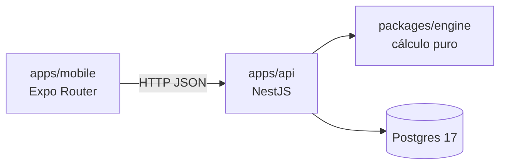

# Green Light

Agente financiero personal en pesos colombianos que avisa si una decisión te deja sin plata a fin de mes.

## Qué hace

**Productos**

- Tarjetas de crédito con cupo, día de corte, día límite de pago, cuota de manejo, seguro e historial de tasas (E.A. o M.V.). La deuda que la tarjeta ya traía se carga por grupos de cuotas (compras con las mismas cuotas pendientes) y la app muestra el plan de pagos por corte.
- Préstamos de libre inversión con cronograma de pagos y seguro fijo o como porcentaje del saldo.
- Cuentas de ahorros o corriente, con saldo confirmado por fecha.
- Cualquier producto se puede archivar, desarchivar o eliminar.

**Movimientos**

- Gastos con categoría, ingresos puntuales, ingresos recurrentes y gastos fijos.
- Los ingresos y gastos fijos se pueden terminar, cambiar de monto y reactivar si se terminaron por error.
- Abonos a capital de tarjetas y préstamos, desde una cuenta o con dinero externo, para reducir plazo o reducir cuota. En un préstamo se ve cómo queda el cronograma antes de guardar.

**Respuestas**

- Inicio muestra el saldo actual, los compromisos del mes (tarjetas por corte, gastos fijos y cuotas de préstamo) y el **restante real** a fin de mes. Al registrar un gasto, avisa si deja el saldo en negativo.
- Proyección del fin de mes y de los meses siguientes (3 por defecto, hasta 24) con **semáforo**: rojo si el mes cierra en negativo, amarillo si pasa por negativo o cierra con menos del 10 % del ingreso, verde en el resto.
- Alertas cuando una tarjeta usa más del 30 % del cupo o cuando los pagos de deuda del mes superan el 30 % del ingreso.
- Simulador de compras con tarjeta: compara la misma compra a 1, 3, 6 y 12 cuotas y dice si alcanza, si queda justo o si no cabe en el cupo.
- Validación del mínimo contra el extracto: compara el pago mínimo calculado con el que cobra el banco y avisa si difieren más de 2 %.

Los porcentajes (10 %, 30 %, 2 %) son los valores por defecto de la tabla `settings` y se cambian con `PATCH /settings`.

## Arquitectura

Monorepo de npm workspaces (`apps/*` y `packages/*`).

| Paquete | Nombre | Qué es |
| --- | --- | --- |
| `packages/engine` | `@greenlight/engine` | Motor de cálculo en TypeScript puro: tasas, amortización, cortes de tarjeta, préstamos, proyección, simulador y validación del extracto. Su única dependencia es `decimal.js`. |
| `apps/api` | `@greenlight/api` | API REST con NestJS 11, TypeORM y Postgres. El esquema solo cambia con migraciones (`synchronize: false`). Escucha en el puerto 3001. |
| `apps/mobile` | `@greenlight/mobile` | App con Expo Router y TanStack Query. Pestañas: Inicio, Simular, Productos y Mensual, con un botón central para agregar movimientos. |



La app no importa el motor: habla solo con la API, y la API le pasa los datos al motor.

**Por qué el motor está separado.** Las reglas financieras no dependen de Nest, de la base de datos ni de la interfaz, así que se prueban solas y rápido, y un cambio en la API o en la app no puede alterar un cálculo.

**Por qué no se usa `float`.** Con `float`, `0.1 + 0.2` no da `0.3`, y ese error se acumula cuota tras cuota. El dinero se guarda en centavos enteros (`bigint` en Postgres) y las tasas y divisiones se calculan con `decimal.js`, redondeando al centavo solo al final.

## Requisitos

- Node 24 (la versión exacta está en `.nvmrc`; `package.json` exige `>=24`).
- npm (viene con Node).
- Docker Desktop, para Postgres.

En Windows, usa comillas dobles en los argumentos de los comandos: las simples no funcionan en `cmd`.

## Instalación y arranque local

Todos los comandos se ejecutan desde la raíz del repo.

1. Instala las dependencias de todos los paquetes:

   ```bash
   npm install
   ```

2. Levanta Postgres 17 (Docker Desktop tiene que estar abierto):

   ```bash
   docker compose up -d
   ```

   Queda publicado en `127.0.0.1:5432` y no en todas las interfaces: con las credenciales de desarrollo, cualquiera en la misma red podría entrar a la base.

3. Crea el archivo de entorno de la API a partir del ejemplo:

   ```bash
   cp apps/api/.env.example apps/api/.env
   ```

   En `cmd` de Windows: `copy apps\api\.env.example apps\api\.env`.

   ```env
   DB_HOST=localhost
   DB_PORT=5432
   DB_USER=greenlight
   DB_PASSWORD=greenlight
   DB_NAME=greenlight
   ```

   El usuario y la clave `greenlight` son los de `docker-compose.yml` y sirven solo para desarrollo local. Los archivos `.env` no se suben a git.

   Además, la API **no arranca** sin dos variables que no tienen valor por defecto. Agrégalas al mismo `apps/api/.env`:

   ```env
   JWT_SECRET=<48 caracteres aleatorios, mínimo 32>
   INVITE_CODE=<el código que pedirá el registro>
   ```

   Genera el secreto con `node -e "console.log(require('crypto').randomBytes(48).toString('base64url'))"`. Más detalle en el [README de la API](apps/api/README.md).

4. Compila el motor. La API importa `packages/engine/dist`, que no está en el repo:

   ```bash
   npm run build -w @greenlight/engine
   ```

   Hay que repetirlo cada vez que cambie el motor.

5. Crea las tablas:

   ```bash
   npm run migration:run -w @greenlight/api
   ```

6. Arranca la API en modo desarrollo:

   ```bash
   npm run start:dev -w @greenlight/api
   ```

   Queda en `http://localhost:3001` (otro puerto con la variable `PORT`). `GET /` responde `GreenLight: $1.234.567`; todo lo demás pide iniciar sesión.

7. Crea `apps/mobile/.env` con la dirección de la API:

   ```env
   EXPO_PUBLIC_API_URL=http://localhost:3001
   ```

8. En otra terminal, arranca la app en el navegador:

   ```bash
   npm run web -w @greenlight/mobile
   ```

   Abre `http://localhost:8081`. La API solo acepta por CORS ese origen, así que la versión web tiene que correr en ese puerto.

   Para probar en un celular con Expo Go, usa `npm run start -w @greenlight/mobile`. En un celular físico, `EXPO_PUBLIC_API_URL` debe llevar la IP del PC en la red local (por ejemplo `http://192.168.1.20:3001`), no `localhost`.

La primera vez, crea tu cuenta en la pantalla de registro con el `INVITE_CODE` de tu `.env`. Después necesitas al menos una cuenta bancaria con saldo confirmado para proyectar: créala en la pestaña Productos.

## Scripts útiles

Se ejecutan desde la raíz con `npm run <script> -w <paquete>`.

**`@greenlight/engine`**

| Script | Qué hace |
| --- | --- |
| `build` | Compila a `dist/` con `tsc`. |
| `test` | Corre las pruebas con Vitest. |
| `test:watch` | Vitest en modo observación. |

**`@greenlight/api`**

| Script | Qué hace |
| --- | --- |
| `start:dev` | Arranca la API y recarga al guardar. |
| `build` / `start:prod` | Compila con `nest build` y ejecuta `dist/main`. |
| `test` | Pruebas unitarias con Jest (`*.spec.ts`). |
| `test:cov` | Pruebas con cobertura. |
| `test:e2e` | Prueba de extremo a extremo; necesita Postgres arriba. |
| `lint:check` | ESLint sin modificar archivos. |
| `lint` | ESLint con `--fix`. |
| `format` | Prettier sobre `src` y `test`. |
| `migration:run` | Aplica las migraciones pendientes. |
| `migration:revert` | Deshace la última migración. |
| `migration:generate` | Genera una migración con los cambios de las entidades. |

Para generar una migración, la ruta va después de `--` y es relativa a `apps/api`:

```bash
npm run migration:generate -w @greenlight/api -- "src/database/migrations/NombreDelCambio"
```

**`@greenlight/mobile`**

| Script | Qué hace |
| --- | --- |
| `web` | Arranca la app en el navegador. |
| `start` | Arranca el servidor de Expo (Expo Go). |
| `android` / `ios` | Arranca y abre en un emulador o dispositivo. |
| `test` | Pruebas con Jest (`jest-expo`). |
| `lint` | `expo lint`. |
| `format` / `format:check` | Prettier sobre `src`. |

En `apps/api/requests/` hay archivos `.http` con peticiones de ejemplo para cada módulo.

## Pruebas y calidad

```bash
npm test -w @greenlight/engine
npm test -w @greenlight/api
npm test -w @greenlight/mobile
```

El motor se prueba con Vitest; la API y la app, con Jest. Las pruebas de la API importan el motor compilado, así que primero hay que correr `npm run build -w @greenlight/engine`. Usa `npm test`, no `npx jest` suelto (la API necesita un flag de Node que el script ya pone).

La API tiene además pruebas de extremo a extremo (la app completa, el aislamiento entre usuarios y la migración) que necesitan el Postgres local arriba. Crean y borran bases `gl_e2e_*` y nunca tocan la de tu `.env`:

```bash
docker compose up -d
npm run test:e2e -w @greenlight/api
```

Antes de cada push:

```bash
npm run lint:check -w @greenlight/api
```

```bash
cd apps/mobile
npx expo lint
```

## Flujo de trabajo (git)

- `main` está protegida: no se le hace push directo.
- Cada cambio sale en una rama creada desde `main` actualizado: `feat/…`, `fix/…`, `docs/…`.
- Se integra con un PR en **squash merge**, con el título en Conventional Commits (`feat:`, `fix:`, `docs:`, `chore:`…).

```bash
git checkout main
git pull
git checkout -b feat/nombre-del-cambio
```

## Estado y roadmap

**Hecho**

- Motor: dinero, tasas E.A./M.V., calendario de cortes, amortización, abonos a capital, compras y extractos de tarjeta, préstamos con tasa variable, proyección con semáforo, simulador, validación del mínimo y alertas.
- API: productos (tarjetas, préstamos, cuentas), gastos, categorías, ingresos, gastos fijos, abonos a capital, ajustes, proyección, simulaciones y validación de extractos. Multiusuario: registro con código de invitación, login con JWT (argon2id) y datos separados por usuario.
- App: Inicio con saldo actual, restante real y compromisos del mes; movimientos y próximos pagos; simulador; alta y edición de productos; deuda inicial por grupos y plan de pagos por corte; préstamos con cronograma y abonos; ingresos y gastos fijos; inicio de sesión, registro y cierre de sesión.

**Siguiente**

- Despliegue de la API en Render y Postgres en Neon (`sslmode=require`, `TZ=America/Bogota`, `TRUST_PROXY=1`).
- APK de Android con EAS.

**Más adelante**

- Saldo por cuenta.
- Lectura de extractos en PDF.
- Gráficas.
- Recomendaciones de pago de deudas (método avalancha).

## Licencia

Proyecto personal, sin licencia por ahora.
